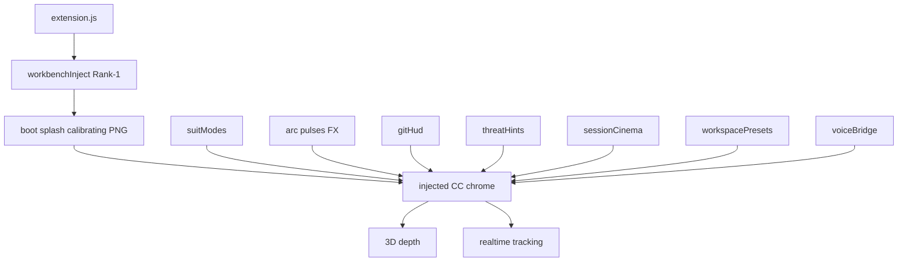

# JARVIS Theme Master — Cold Reopen (Joshua)

> ## IN PROGRESS — Workbench injection installed
>
> **Status:** Phases **1–5 done**. Phase **6** — inject engine + CSS synced; **Program Files workbench patch APPLIED** (Joshua Admin/UAC enable, Nov 7 2026). Corrupt-install warning accepted — do **not** Fix Checksums.
>
> ### After reload (Joshua)
>
> 1. **Reload Window** (or full quit/relaunch) on Recomp IDE (`C:\PS2Recomp`) to see calibrating splash → navy/cyan chrome.
> 2. Dismiss corrupt-install warning if shown — expected; leave checksums alone.
> 3. Optional: **JARVIS: Injection Status** / **Health Check**.
> 4. Continue Phase 6 from **next incomplete sub-phase** (§ Phase 6 status) — boot QA → HUD (Studio YES) → demote → package. Title-bar chrome is **in scope** (`window.titleBarStyle: custom` set); Windows taskbar `.ico` stays **OUT OF SCOPE**.
>
> Workers never elevate. Re-enable / Disable inject is **Joshua Admin only** (writes under Program Files).

**Authority:** Joshua · **Date locked:** Nov 7, 2026  
**Canonical plan:** `jarvis_pro_recreation_a1985356` (if any sibling doc disagrees with plan locks, **the plan wins**; this master consolidates locks + current install state).  
**Extension root:** `C:\PS2Recomp\jarvis-cursor-ui` · **v0.5.0** · installed inject **active on disk**

---

## Sibling docs (sources of truth — do not invent conflicts)

| Doc | Role |
|-----|------|
| Plan `jarvis_pro_recreation_a1985356` | Phase status + Phase 6 ordered build; **wins on conflicts** |
| [`GOD-REQUIREMENTS-PHASE6.md`](./GOD-REQUIREMENTS-PHASE6.md) | God YES checklist; Active support EXCLUDED; Studio column |
| [`phase6-injection-build.md`](./phase6-injection-build.md) | Build mirror of Phase 6 sub-phases |
| [`GOD-ADMIN-ENABLE.md`](./GOD-ADMIN-ENABLE.md) | God Admin enable steps (resume gate) |
| [`INJECTION-APPROACH.md`](./INJECTION-APPROACH.md) | Rank-1 inject audit; fail-safe outline; Cursor install facts |
| [`VISUAL-SPEC-FROM-REFERENCE.md`](./VISUAL-SPEC-FROM-REFERENCE.md) | Pixel/UX from reference PNGs |
| [`PALETTE-MARKETPLACE-VS-REFERENCE.md`](./PALETTE-MARKETPLACE-VS-REFERENCE.md) | Hybrid palette (PNG boot vs marketplace brand) |
| [`MARKETPLACE-JARVIS-3D-EXTRACT.md`](./MARKETPLACE-JARVIS-3D-EXTRACT.md) | Pattern map + Studio matrix; copy patterns only |
| [`../README.md`](../README.md) | User-facing install, fail-safes, commands |

---

## Phase status

| Phase | Status |
|-------|--------|
| **1 — Shell + boot imagery** | **Done** |
| **2 — Suit Modes + FX** | **Done** |
| **3 — Ops HUD** | **Done** |
| **4 — Session / focus / stream** | **Done** |
| **5 — Presets + package** | **Done** |
| **6 — Injection foundation** | **Scaffold started → PAUSED** at safe checkpoint |

### Phase 6 sub-phases

| Sub-phase | Intent | Checkpoint |
|-----------|--------|------------|
| **6.3.A Scaffold** | `workbenchInject.js`, `media/inject/{tokens,boot,hud}.css`, `jarvis.injection.*` settings/commands, `extension.js` gate | **STARTED / on disk — leave as-is** |
| **6.3.B Fail-safe 1** | Auto-disable on Cursor update (fingerprint) | Scaffold wired; verify on Admin enable |
| **6.3.C Fail-safe 2** | Disable on patch/probe fail | Scaffold wired; verify on Admin enable |
| **6.3.D Fail-safe 3** | God-as-builder docs (**not** Active support) | Documented in README / this master |
| **6.3.E Boot** | Full-bleed calibrating PNG → `bootMs` → reveal | Scaffold CSS present; **Admin enable + QA still pending** |
| **6.3.F HUD** | Inject CC regions; Studio YES (3D/anim/arc/tracking/…) | **Not complete** — next major build after resume |
| **6.3.G Demote** | Webview not primary when inject on; no overlays | Partial (fallbackWebview default false) |
| **6.3.H Verify + package** | PNG QA, Studio checklist, fail-safe tests, VSIX | **Pending** |
| **6.3.J Title bar** | Custom `titleBarStyle` + inject CSS (chrome + top-corner icon styling) | **YES — in scope** (scheduled with HUD/chrome) |
| **6.3.I Taskbar `.ico`** | Electron/app or shortcut icon replace | **OUT OF SCOPE for now** |

**Do not** reopen Phases 1–5 unless God explicitly reopens them.  
**Do not** implement Active support. **Do not** add overlays. **Do not** depend on a third-party CSS loader.

---

## Visual targets (from reference PNGs)

**Primary boot / first-paint:** [`media/reference-calibrating-splash.png`](../media/reference-calibrating-splash.png) (638×480)

- Full-bleed on IDE launch via **injection** (not a separate exe).
- Copy stack: `J.A.R.V.I.S.` → `JUST A RATHER VERY INTELLIGENT SYSTEM` → `CALIBRATING` → `N%` → five step dots.
- Charcoal void ≈ `#0E121A`; cyan bloom / ring / bar from splash samples (`#0FDEFF`–`#00f2ff` family).
- Detail geometry, tokens, acceptance: [`VISUAL-SPEC-FROM-REFERENCE.md`](./VISUAL-SPEC-FROM-REFERENCE.md) §1.

**Post-boot Command Center chrome:**  
[`media/reference-command-center.png`](../media/reference-command-center.png) + [`-2.png`](../media/reference-command-center-2.png) (1024×573)

- Glass navy dashboard; left nav; SYSTEM STATUS · OPTIMAL; cyan clock; globe hero; Talk capsule; footer meta.
- Injection must restyle the **entire Cursor window** (title bar, activity bar, sidebar, tabs, panel, status bar) — webview alone is insufficient.
- Detail: visual-spec §2–§3.

**Overlays:** Forbidden (no floating / editor-wide overlay HUD).

---

## Marketplace / God Studio YES list

God lock: every Studio-tier option **YES** on the local theme — unlocked, **no Gumroad**.  
**Active support = EXPLICITLY OUT** (God was only reading the marketplace list).

### God marketing / feature bullets (all YES)

| # | Item | Meaning |
|---|------|---------|
| 1 | **3D real depth** | Layered z / perspective / parallax — not flat tint only |
| 2 | **Realtime animation** | Continuous live HUD/FX motion |
| 3 | **Active responses** | Activity-aware chrome (editor/session/agent/threat/voice) |
| 4 | **Arc pulses** | Pulsing arc-reactor motif synced to energy/activity |
| 5 | **Peer innovation** | = **first-party innovation** parity goals — **NOT** active/peer support |
| 6 | **Realtime tracking** | Coding / energy / session metrics in HUD |
| 7 | **30% optimized colors** | Calibrated palette; God “30%” vs stock Cursor contrast |
| 8 | **Built-in HUD** | Injected Command Center chrome |
| 9 | **Classic Jarvis theme + icon** | Classic color theme + icon theme |
| 10 | **Basic HUD** | Status strips, reactor, core chips |
| 11 | **Arc + energy** | Reactor + energy readouts |
| 12 | **EVERY studio option YES** | Full Studio column (below) |

### Studio column (local)

| Studio / marketplace row | On God's theme |
|--------------------------|----------------|
| Classic theme + icons | **YES** |
| Basic HUD / arc / energy | **YES** |
| Standard performance | **YES** |
| Suit Modes | **YES** |
| Particles / arc / streams / glow | **YES** |
| F.R.I.D.A.Y. / TTS / sound | **YES** |
| Session Cinema / Stream Pack / Focus Fortress | **YES** |
| Threat / GitHUD / Dashboard | **YES** |
| AI Companion / presets | **YES** |
| Multi-device | **N/A (local)** |
| Stream watermark | **Optional local** |
| Seasonal suits | **YES** |
| **Active support** | **EXCLUDED — OUT** |

Full module → inject map: [`GOD-REQUIREMENTS-PHASE6.md`](./GOD-REQUIREMENTS-PHASE6.md).

---

## Hybrid palette (locked)

| Surface | Prefer | Why |
|---------|--------|-----|
| **Boot / splash** | **Splash PNG samples** (`#0E121A`, `#0FDEFF`–`#00f2ff`, bar/ring/dots) | Pixel-match calibrating primary |
| **Brand / product cyan** | **Marketplace** primary `#00d9ff` (and related brand tokens where not splash-locked) | Suit / theme / listing coherence |
| **CC glass / Optimal green when matching refs** | **PNG / CC samples** | Screenshot match (muted teal-green, not neon `#00ff9f`) |

Do **not** replace splash bloom cyan with marketplace `#00d9ff` if that softens the calibrating still. Dual vars OK (`--jarvis-cyan-brand` + bloom `--jarvis-cyan`).  
Detail table: [`PALETTE-MARKETPLACE-VS-REFERENCE.md`](./PALETTE-MARKETPLACE-VS-REFERENCE.md).

---

## Three fail-safes (LOCKED)

1. **Auto-disable on update** — Cursor version/commit (fingerprint) change → teardown patch, disable, notify; **never** auto-re-enable.
2. **Disable on patch detect** — Missing/corrupt markers or health-probe fail → teardown, disable, notify.
3. **God-as-builder / no outside-support gap** — God owns Admin enable, integrity warning, rebuilds, re-enable after verify. **This is NOT marketplace “Active support.”** Do not rebrand fail-safe 3 as community/vendor support.

Integrity / “corrupt installation” warning: **accepted** — do **not** implement Fix Checksums; do **not** block Phase 6 on it.

---

## Injection standard (LOCKED)

**Pattern class:** Custom CSS Loader / CSS Injector / Custom UI Style — **extension-owned** `workbench.html` inject.

| Rule | Value |
|------|--------|
| Module | `src/workbenchInject.js` |
| CSS | Marked inline `<style>` from `media/inject/{tokens,boot,hud}.css` before `</head>` |
| Third-party loader | **No runtime dependency** (be5invis / YUYUMOE / APC are research refs only) |
| Default enabled | `jarvis.injection.enabled` = **false** until God Enable |
| CSP | CSS-first; do **not** strip Cursor CSP for CSS-only path |
| Write ACL | Program Files → **Admin once** for Enable/Disable; soft-fail with clear message |
| Commands | `jarvis.injection.enable` / `disable` / `reenableAfterUpdate` / `healthCheck` / `status` |

Audit detail: [`INJECTION-APPROACH.md`](./INJECTION-APPROACH.md).

---

## Title bar / icons / taskbar

| Target | Lock | Method |
|--------|------|--------|
| **Title bar chrome** (colors, glow, controls styling) | **YES** | `"window.titleBarStyle": "custom"` + inject CSS (`.part.titlebar` / custom-titlebar) |
| **Top-corner / in-window app icon styling** | **YES** | Same custom titleBar + inject CSS (e.g. `.window-appicon` size/filter/hide/tint). Bitmap **replacement** still needs `.ico` if God later wants a new glyph — not required for YES chrome path |
| **Windows taskbar icon** | **OUT OF SCOPE for now** | Needs exe / resource / shortcut `.ico` replace — **not** pure CSS. Do not schedule 6.I until God reopens |

---

## On-disk scaffold inventory (leave as-is)

Do **not** delete. Do **not** replace with new inject feature work while PAUSED.

| Path | Role |
|------|------|
| `src/workbenchInject.js` | Rank-1 inject engine (locate / backup / patch / teardown / fingerprint / health) |
| `media/inject/tokens.css` | Calibrated / 30% palette CSS variables |
| `media/inject/boot.css` | Calibrating splash cover |
| `media/inject/hud.css` | Post-boot chrome hooks (scaffold; Studio YES HUD incomplete) |
| `media/reference-calibrating-splash.png` | Boot asset (staged/copied on enable per inject engine) |
| `package.json` → `jarvis.injection.*` | Settings: `enabled`, `bootMs`, `fallbackWebview` |
| Commands | `jarvis.injection.enable` / `disable` / `reenableAfterUpdate` / `healthCheck` / `status` |
| `src/extension.js` | Activate gate → reconcile; command wiring |

Phases 1–5 modules remain: `suitModes`, `gitHud`, `threatHints`, `sessionCinema`, `workspacePresets`, `voiceBridge`, themes, Command Center webview (demoted / fallback).

---

## Boot on IDE launch

- **Asset:** `reference-calibrating-splash.png` only (not command-center PNG as boot).
- **Delivery:** Workbench injection on Cursor/IDE launch → full-bleed cover → hold `jarvis.injection.bootMs` (default 1200) → fade/reveal HUD.
- **Not** a separate splash executable.
- Corrupt warning after patch is expected UX.

---

## Startup scope — Recomp folder IDE-only

| Lock | Value |
|------|--------|
| **Primary product scope** | JARVIS inject / theme work targets the **Recomp folder IDE** session (`C:\PS2Recomp` / this extension workspace) |
| **Document** | Treat Recomp Cursor window as the verify / Admin-enable / QA surface |
| **One window** | `window.restoreWindows: "one"`; do **not** dual-restore `E:\PS2Recomp.code-workspace` + folder; no Startup-folder Cursor shortcuts |
| **Splash** | Injection path only (`boot.css` / `jarvis.injection.*`) — never a separate splash exe or new window to show it |
| **Sibling note** | A sibling agent or other Cursor window **may apply settings** that affect user/global Cursor config; that does not expand product scope — still document and verify against **Recomp IDE** |

Full write-up: [`STARTUP-IDE-ONLY.md`](./STARTUP-IDE-ONLY.md). Workers soft-fail on Admin; Joshua enables inject in the Recomp-scoped Admin session per [`GOD-ADMIN-ENABLE.md`](./GOD-ADMIN-ENABLE.md).

---

## Architecture (target)

Core idea: IDE launch → calibrating PNG via inject → Command Center chrome with Studio YES completeness. No overlay path. No Gumroad. No Active support.

---

## Explicit exclusions

- Marketplace **Active support** / community/vendor support product claims  
- Gumroad / paid unlock / trial soft-lock overlays  
- Third-party Custom CSS Loader as a **required** dependency  
- Floating / editor overlay HUD as primary UI  
- Windows **taskbar** `.ico` work (out of scope now)  
- Copying NextGenCode VSIX / CSS / assets  
- Fix Checksums as a Phase 6 blocker  
- Treating “peer innovation” as peer/third-party support  

---

## Resume checklist (Joshua)

- [ ] Cold-reopen this master + plan  
- [ ] Scaffold files still present (inventory above)  
- [ ] Admin Enable per [`GOD-ADMIN-ENABLE.md`](./GOD-ADMIN-ENABLE.md)  
- [ ] Boot splash matches calibrating PNG  
- [ ] Fail-safes 1–2 behave on fake update / broken markers  
- [ ] Continue **6.3.E → 6.3.F → 6.3.G → 6.3.H**; include **title bar YES** via custom `titleBarStyle` + inject  
- [ ] Leave taskbar `.ico` alone until God reopens 6.I  
- [ ] Keep Active support OUT; keep hybrid palette; keep Recomp IDE as verify scope  

---

*Master consolidate for cold reopen. Sibling docs remain authoritative detail; plan wins on lock conflicts. PAUSED at scaffold — Enable inject as Admin after reopen.*
